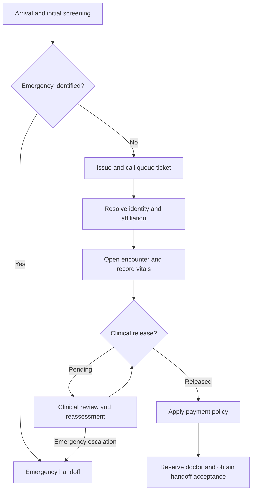

# Hospital reception: top-down reusable design guide

Design baseline: 12 November 2026. LCE Studio 0.8 adds an executable reference workflow following this design; use [HOSPITAL_RECEPTION_REPLICATION.md](HOSPITAL_RECEPTION_REPLICATION.md) to run and recreate it. This is a software model, not a clinical treatment protocol or deployed reception application. All scenario data should be synthetic.

## 1. Name the boundary before drawing the process

Create the conceptual target **HospitalReception**, a reusable workflow capability. Its parent can be a clinic application, hospital system or multi-hospital ecosystem. Its definition does not contain a particular hospital's name, database URL, doctors or payment rules. Those belong to instance configuration and external bindings.

Use these coordinates:

- Kind: component, with stateful workflow behavior.
- Definition: `health.reception`, version `1.0.0` when its first contract is tested and ready to freeze.
- Instance example: `hospitalA.outpatientReception`.
- Purpose: take responsibility for an arrival until a consultation handoff, emergency handoff or explicit alternative disposition is recorded.
- Outside this boundary: consultation, diagnosis, actual treatment, hospital-wide patient identity, insurance adjudication, monetary settlement and ECU bed management. Reception calls their interfaces and records outcomes.

The process owns a **reception case**, not the patient's complete medical record. A patient, an arrival, a queue ticket, a reception case and a clinical encounter have different identities. A repeat visit must not accidentally reuse an earlier encounter just because the patient ID is the same.

At every level use the same component card:

| Contract field | What to specify |
| --- | --- |
| Identity and kind | Namespaced definition ID, version and behavior/state/workflow/adapter kind |
| Inputs and commands | Typed values, required context and preconditions |
| Outputs and events | Success, pending, rejection and failure outcomes; correlation IDs |
| Owned state | What only this component may change, and what must survive restart |
| Dependencies | Exact component definitions and required external interfaces |
| Policy parameters | Versioned configuration, accepted values and units |
| Guarantees | Invariants, duplicate handling, concurrency and cancellation rules |
| Evidence | Independently specified normal, boundary and failure tests |

**Completion criterion:** a consumer can understand and test the component without opening its internals.

## 2. Define the public reception contract

| Area | Proposed contract |
| --- | --- |
| Start | `StartReception(arrivalId, facilityId, serviceId, requestId)`; a patient ID is not required at arrival |
| Human/system inputs | Present identity, confirm identity match, provide affiliation evidence, record observations, record clinical disposition, record payment disposition, request dispatch, confirm receiving-doctor acceptance |
| Interrupt | `EscalateEmergency(caseId, assessmentRef, actorRef, requestId)` at any active stage |
| Other lifecycle inputs | Cancel/leave, reconcile identity, retry a pending operation, release a reservation |
| Normal result | `ConsultationHandoffAccepted(caseId, patientRef, encounterRef, assignmentRef)` |
| Emergency result | `EmergencyHandoffAccepted(caseId, provisionalOrConfirmedIdentityRef, emergencyEncounterRef, receivingUnitRef)` |
| Other outcomes | Waiting with an explicit reason, unresolved identity, pending verification, cancelled/left, failed dependency or manual intervention required |
| Configured dependencies | Queue, patient registry, affiliation provider, encounter service, clinical task service, payment-policy service, workforce/assignment service and audit/access services |

Do not report completion merely because a message was sent or acknowledged by software. A receiving professional's acceptance is a distinct business event.

Proposed invariants:

1. An emergency escalation cannot be blocked by a queue number, identity lookup, registration, affiliation or payment.
2. Routine dispatch requires an encounter, accepted observation status, clinical release and a payment-policy disposition that permits this workflow to proceed.
3. Unknown affiliation is not confirmed absence of affiliation. A timeout is not a negative lookup result.
4. A repeated request does not create a second ticket, patient, encounter, bill or assignment.
5. A doctor cannot be assigned beyond the capacity reserved by the authoritative assignment owner.
6. Every observation, decision, override and handoff has an actor/source, time and relevant policy/version reference.
7. Tenant and facility identifiers alone do not confer access. Cross-organization access requires explicit authorization.

## 3. Draw the normal route and its interrupt separately

The user's queue-first process gains an initial clinical screening point. WHO describes acuity-based triage as distinguishing patients requiring immediate intervention from those who can wait. Our resulting software requirement is that administrative work must not become a prerequisite for emergency escalation. Clinical assessment and treatment remain professional tasks under local protocols, not invented software rules. See source [1].



This is a conceptual process diagram, not executable BPMN. In addition to the illustrated branch, emergency escalation can interrupt **every active stage**, including waiting, registration, finance and dispatch. The review loop ends through release, escalation or another explicit disposition; it must not spin automatically or wait indefinitely without an escalation policy.

For fever, the workflow records an observation/alert, requests clinical review and records interventions and reassessments. A clinician records whether normal dispatch may resume. No treatment, medication, universal temperature threshold or rule requiring temperature normalization is specified here. The observation and any active alert are time-scoped and linked to the encounter; they are not a permanent `patient.hasFever` Boolean.

Treat ECU as the configured emergency receiving unit. Immediate care and provisional documentation must be possible without waiting for the ordinary registration path; identity reconciliation can follow. A request to an unavailable ECU is not a successful admission: retain a pending escalation and invoke the facility's alternate handoff process.

## 4. Decompose the root into reusable capabilities

These are logical responsibilities, not a requirement to deploy ten services. Several can be modules in one application while retaining their contracts.

| ID / capability | Subcomponents | Public result and reuse boundary |
| --- | --- | --- |
| R0 ReceptionCoordinator | Stage transition, prerequisite check, correlation, interrupt routing, cancellation/recovery | Owns case progress; orchestrates the other capabilities without owning their records |
| R1 ArrivalQueue | Ticket issuance, waiting-line policy, call/recall, attendance/no-show | Ticket and called/served/left events; reuse in laboratories, pharmacies and public service desks |
| R2 PatientIdentity | Registry lookup, match classification, clerk confirmation, registration, provisional identity/reconciliation | Confirmed or provisional patient reference; reusable party-resolution core with a healthcare wrapper |
| R3 Affiliation | Evidence retrieval, validity policy, affiliation classification, review/refresh | Verified, confirmed-none or unresolved disposition; configurable for employer, insurer or membership schemes |
| R4 EncounterOpening | Episode-key check, open/reuse decision, encounter creation, patient association | One encounter reference for the intended visit/episode; reuse across outpatient departments |
| R5 VitalSigns | Capture task, measurement validation, observation recording, missing/refused status | Observation references and completion/review status; reusable measurement capture with clinical configuration |
| R6 ClinicalReadiness | Clinical screening task, alert assessment, fever review, reassessment, release decision | Release, review or emergency disposition; generic review lifecycle with professionally governed content |
| R7 EmergencyHandoff | Preemption, provisional case support, receiving-unit request, acceptance/alternate route, later reconciliation | Accepted emergency handoff or explicit pending escalation; reusable urgent escalation lifecycle |
| R8 PaymentDisposition | Policy evaluation, coverage/waiver/defer checks, financial-task request, disposition recording | Proceed, defer, waive, routine administrative review or policy error; actual payment is a separate operation |
| R9 ConsultationDispatch | Eligible-provider discovery, ranking, dispatcher choice, atomic reservation, notification, acceptance/release | Accepted assignment or waiting/reselection; reusable capacity allocation with healthcare eligibility rules |

Every row can have its own component card and independent tests. Reusing R1 never requires importing R2–R9. Reusing the whole root requires providing its declared dependencies, not copying their implementations into every hospital.

## 5. Define shared data contracts and ownership

Define these before connecting ports. Keep records small and refer to separately owned records by typed IDs.

| Record / owner | Minimum design information |
| --- | --- |
| Arrival / Reception | Arrival ID, facility, service, arrival time, correlation ID |
| ReceptionCase / Coordinator | Case ID, arrival reference, current stage, interruption status, revision, disposition |
| QueueTicket / Queue | Internal ticket ID, queue ID, session/day, display number, status, issued time |
| Patient and IdentityEvidence / Registry | Stable patient ID, identifier issuer/value, identity status, verification provenance |
| CasePatientLink / Coordinator | Case reference, patient reference, link status and reconciliation provenance |
| AffiliationAssessment / Affiliation | Patient, scheme/provider, verified/none/unresolved status, validity period, evidence source and checked time |
| Encounter / Encounter service | Encounter ID, patient reference, facility, visit/episode key, lifecycle and encounter type |
| Observation / Clinical record service | Subject/encounter, code, value and unit, observation status, measured time and recorder |
| ClinicalReview / Clinical task service | Case/encounter, reason, requested/active/completed status, reviewer and disposition |
| ClinicalAlert / Clinical record service | Patient/encounter reference, source observation, active/resolved status and times |
| PaymentDecision / Finance | Case/encounter, policy version, disposition, currency/amount if relevant, reasons and evidence references |
| ProviderSlot / Assignment owner | Provider, facility/service eligibility, shift/availability, capacity and revision |
| Assignment / Assignment owner | Encounter, reserved slot/provider, lifecycle, reservation token and receiving acceptance |
| AuditEntry / Audit service | Actor, operation, subject references, outcome, policy, time and correlation; omit unnecessary clinical content |

Patient identifiers need an issuer/namespace; names alone are not an identity key. Queue display numbers are local labels, not globally unique patient or encounter IDs. An affiliation decision is separate from a payment decision.

FHIR's distinction between Patient, Encounter and Observation is a useful interoperability reference [2–3]. These proposed records are not FHIR-conformant resources. An explicit versioned mapping/adapter is a later deliverable.

**Current LCE encoding:** Data records support required Boolean, integer and string fields, plus typed collections of flat records. Use explicit status strings and validation components for allowed statuses. For optional links, use a separate link entity with zero rows until known, rather than a fake patient foreign key. Use scaled integers with documented units for measurements and integer minor units plus currency for money. The engine does not automatically validate timestamps, status enumerations, clinical units or currency policy. Missing observations need explicit status/absence records; never represent a missing temperature as zero.

## 6. Separate reusable decision components from effects and people

| Leaf family | Examples | How it executes |
| --- | --- | --- |
| Pure decision | Lookup classification, affiliation eligibility, dispatch prerequisites | Explicit inputs to a deterministic Components definition |
| Owned-state operation | Issue a ticket, change case stage, reserve capacity | Decision plus guarded atomic commit, revision and idempotency semantics |
| External adapter | Query registry, persist encounter, payment provider, send notification | Implemented integration with declared failure/retry contracts |
| Human task | Confirm identity, take vitals, assess emergency, manage fever, accept handoff | Request, authorized actor action, recorded completion or escalation |

A human task is not a primitive that magically performs care. A pure `select` cannot execute a database write. Decomposition stops at explicitly supported engine semantics, or at a clearly marked adapter/human boundary requiring implementation.

## 7. Trace every capability down to its leaves

The operation names below match current pure primitives where shown in code formatting. State, adapter and task leaves are separate from the pure primitive catalog.

| Capability | Reusable decision leaves → pure primitives | Other required leaves |
| --- | --- | --- |
| R0 Coordinator | StageEquals → `equal`; CanAdvance → `and`, `not`; NextStage → `select`; case payload → `record_make` | Revision-checked state transition, durable receipt, conditional effect, task cancellation and explicit interrupt protocol |
| R1 Queue | CanIssue/CanCall → `equal`, `and`, `not`; IncrementSequence → `add`; StablePriorityChoice → `less_than`, `equal`, `and`, `or`, `select` | Atomic queue owner; collision-safe ticket ID; display/printer/call adapter; authorized call/no-show task; future clock/scheduling |
| R2 Identity | MatchCount → `collection_count`; ClassifyLookup → `equal`, `select`; SameIdentifier → `equal`, `and`; allowed registration → `and`, `not` | Registry query, duplicate-safe registration transaction, clerk confirmation and reconciliation |
| R3 Affiliation | WithinValidity → `less_or_equal`, `and`; SchemeMatches → `equal`; classify verified/none/unresolved → `and`, `not`, `select` | Evidence query, verification task, versioned policy, time supplied explicitly |
| R4 Encounter | SameEpisode → `equal`, `and`; OpenOrReuse → `select`; EncounterRequest → `record_make` | Idempotent encounter owner/adapter; uniqueness by agreed episode key; provisional emergency linkage |
| R5 Vitals | UnitMatches → `equal`; WithinRepresentationBounds → `less_or_equal`, `and`; RecordObservation → `record_make`; read fields → `record_get` | Human/device capture, observation persistence, unit conversion adapter, provenance and absence handling |
| R6 Readiness | ThresholdComparison → `less_or_equal`; ReviewRequired/CanRelease → `and`, `or`, `not`, `equal`, `select` | Approved protocol data; clinician assessment, intervention/reassessment tasks; encounter-scoped alert lifecycle |
| R7 Emergency | IsEmergencyDisposition → `equal`; RouteEmergency → `select`; suppress routine readiness → `not`, `and` | Preemptive workflow transition, cancel/release pending routine work, request emergency handoff, professional acceptance and reconciliation |
| R8 Payment | PolicyCondition → `equal`, `less_or_equal`, `and`, `or`, `not`; ChooseDisposition → `select`; simple totals where applicable → `add`, `subtract` | Authoritative policy/coverage inputs; billing and payment adapters; waiver/defer authorization; currency rules |
| R9 Dispatch | CandidateEligible → `equal`, `less_than`, `and`; BetterCandidate → `less_than`, `equal`, `and`, `or`, `select`; HasCapacity → `less_than` | Workforce query, dispatcher action, atomic reservation and release, receiving acceptance, future expiry timer |
| Shared access/audit | ScopeMatches → `equal`, `and`; DecisionEnvelope → `record_make`; selected fields → `record_get` | Identity/authentication adapter, enforced authorization at operation boundaries, append-only audit/storage policy |

This table covers the behavior leaves but does not turn integrations into available LCE features. General database queries, arbitrary filtering/sorting/folding of collections, automatic human workflows and wall-clock timers are not supplied by the current pure evaluator.

## 8. Author the first pure component: EntryRoute

This is a software routing decision based on a professionally supplied assessment; it does not diagnose an emergency.

An importable [EntryRoute bundle](../examples/composites/reception-entry-route.json) accompanies this guide. Its four independently specified truth-table tests pass with the current Go component checker. You can either build it using the steps below or choose **Components → Import bundle** and select that file, then inspect **Composition** and **Evaluate & test**. If you change an already installed definition, including its saved layout, use a new version rather than overwriting its immutable identity.

1. Open **Components → New definition**.
2. Set ID `health.reception.entry-route` and name `Entry route`. Keep the definition local until tested.
3. In **Typed interface**, add inputs `assessmentRecorded:boolean` and `emergencyIdentified:boolean`.
4. Add outputs `route:string` and `routineAllowed:boolean`.
5. In **Composition**, use the right-side **Component library → Primitives** to drag or add two Select nodes, one Not node and one And node. Select each placed node and configure its required bindings in the left inspector. Bind the graph as follows:

| Node | Operation and bindings |
| --- | --- |
| knownRoute | `select(condition=assessmentRecorded, trueValue="routine", falseValue="awaitAssessment")` |
| finalRoute | `select(condition=emergencyIdentified, trueValue="emergency", falseValue=knownRoute.result)` |
| noEmergency | `not(value=emergencyIdentified)` |
| allowRoutine | `and(left=assessmentRecorded, right=noEmergency.result)` |

6. Bind `route` to `finalRoute.result` and `routineAllowed` to `allowRoutine.result`.
7. In **Evaluate & test**, enter independent expected values:

| Assessment recorded | Emergency identified | Expected route | Routine allowed |
| --- | --- | --- | --- |
| false | false | awaitAssessment | false |
| true | false | routine | true |
| false | true | emergency | false |
| true | true | emergency | false |

8. Validate, evaluate every row, then install/export the tested version. Call this component from larger decision definitions through its exact version.

To repeat the supplied bundle check without a database:

```sh
go run ./cmd/componentcheck --test examples/composites/reception-entry-route.json
```

The emergency input represents a trusted assessment/escalation signal. Missing final paperwork must not suppress that signal. Actor authorization and escalation recording belong to the task/adapter and owning state machine.

## 9. Build the other small decisions before their stateful wrappers

### IdentityLookupDisposition

Inputs: `lookupCompleted:boolean`, `matchCount:integer`. Output: `action:string` and `inputValid:boolean`.

- `inputValid = less_or_equal(0, matchCount)`.
- `countIsZero = equal(matchCount, 0)`; `countIsOne = equal(matchCount, 1)`.
- Nested `select` nodes return `register`, `confirmMatch` or `resolveAmbiguity` for a completed valid lookup; otherwise `retryOrManualReview` or `invalidInput`.
- Test zero, one, several and negative counts, and failed lookup with zero count. Failed lookup must never automatically become permission to register.

A query returning one record still needs the configured identity verification. Do not use `collection_at(0)` on an empty collection and expect a Select node to protect it: Select is eager. Keep extraction in a separately invoked valid-result stage, or supply an already validated candidate.

### AffiliationDisposition

Inputs include verification outcome, matching scheme and explicit validity facts/time. Outputs include `status:string`, `noAffiliation:boolean` and `reviewRequired:boolean`.

Use `equal`, `less_or_equal`, `and`, `not` and `select`. Only a confirmed-none outcome sets `noAffiliation=true`; unknown, unavailable, contradictory and expired evidence have explicit policy-dependent outcomes. An expired membership does not silently prove absence of all affiliation. Test validity endpoints and pending verification separately.

### ReviewRequirement and ClinicalRelease

Separate measurement validation, configurable threshold comparison and clinician disposition. `less_or_equal(policyThresholdScaled, measuredValueScaled)` is a reusable inclusive-threshold comparison; it is not a fever diagnosis. Its caller must supply compatible units and an approved applicable policy. The final clinical disposition is supplied by an authorized professional. Test missing/invalid measurement, review pending, release, escalation and reopening after a new assessment.

### RoutineDispatchReady

Inputs: `identityResolved`, `encounterOpen`, `observationsAccepted`, `clinicalRelease`, `financialProceed`, `emergencyActive`, all Boolean. Output:

```
ready = identityResolved AND encounterOpen AND observationsAccepted
        AND clinicalRelease AND financialProceed AND NOT emergencyActive
```

Implement this with five `and` nodes and one `not` node. Test the all-ready case, each missing prerequisite and emergency precedence. `observationsAccepted` is a governed workflow disposition: an authorized reason for missing measurement can be represented without inventing a measurement. `financialProceed` can mean covered, paid, waived or deferred according to policy; it is not synonymous with cash received.

### CandidateEligible and ChooseBetterCandidate

Eligibility compares facility/service compatibility, qualifications supplied by the workforce authority, duty status and remaining capacity. Prefer an eligible candidate over an ineligible one, then apply the configured ranking, then an explicit stable integer tie-break rank. Build the comparisons from `equal`, `less_than`, `and`, `or` and `select`.

For the first bounded prototype, compare two explicitly supplied candidates. Validate nonnegative capacity and unique tie-break ranks. Return `candidateAvailable=false` when neither is eligible. A general roster query and unbounded ranking loop require an adapter or new bounded collection execution support; do not claim they exist because a two-candidate selector works.

Selection is a proposal. The authoritative owner must reserve capacity before an assignment is reported. A stale revision requires reading current state and making a new decision/request; replaying the old command must retain its original request and result.

### PaymentDisposition

For the initial model, consume an explicit policy result: `proceed`, `defer`, `waive`, `reviewRoutine` or `policyError`. Validate it with equality/Boolean operations and derive `financialProceed`. A richer configurable decision table can be composed later. Do not invent prices, coverage guarantees, legal rules or a requirement to withhold care. Emergency routing bypasses this routine gate.

## 10. Wrap decisions in owned-state components

For each owner, define commands as **inputs → pure decision → accepted writes/effects**. Use LCE's existing revision checks and receipt replay rather than implementing a fake transaction with visual arrows.

| Owner | State and commands to design | Independent checks |
| --- | --- | --- |
| Queue owner | Counter/ticket status; Issue, Call, Recall, MarkServed, MarkLeft | Duplicate Issue returns the same ticket; concurrent issue cannot reuse the committed sequence |
| Reception case | Stage, linked IDs/statuses, emergency state, handoff status; Start, RecordResult, Escalate, Cancel | Invalid transition denied; interrupt precedence; late routine results cannot reopen a completed/emergency case |
| Encounter owner | Episode key, encounter reference/lifecycle; OpenForVisit, LinkIdentity | Same episode/request cannot create duplicates; separate visits remain separate |
| Clinical task owner | Review status, assessment version, disposition; RequestReview, RecordAssessment, Release, Escalate | Release requires the authorized current review; new assessment can invalidate an old release |
| Assignment owner | Capacity, reservation and acceptance status; Reserve, Accept, Release | Two competing reservations cannot overbook; acceptance and cancellation races have explicit outcomes |

The production registry and finance owners are separate authoritative dependencies. Tests may provide explicit synthetic responses, marked as test adapters. Do not merge independently owned hospital records merely to fit a diagram.

In State, choose **New state machine**, declare slots/commands, select exact tested decisions, bind owned state and command inputs, and map accepted results to writes/effects. Use durable slots for the facts that must survive modeled restart. Supply your own expected final state, revisions, receipts and effects.

The current runner tests serialized command order and explicit restarts. It does not establish real distributed concurrency, durable production sessions, database transactions or authorization merely by simulating them.

## 11. Specify interruption and handoff races

Give each pending task/reservation a case reference and generation/assessment revision. On emergency escalation, the coordinator commits emergency state and stops authorizing routine transitions. It requests cancellation/release of outstanding routine work; recipients must reject stale task generations or reconcile already-committed work explicitly.

Test both orderings of dispatch versus escalation. A cancelled notification is not proof that a doctor never received it. Keep a distinct record of reservation release, receiving acceptance and emergency handoff. The clinical team must be alerted if conflicting handoffs occurred.

Business request IDs survive retries. A retry of the same request uses the same ID and payload. A genuinely changed request after a revision conflict gets a new ID and remains linked to the original attempt. This prevents both accidental duplicate effects and silent mutation of historical requests.

## 12. Connect small collaboration experiments

In **Messages**, pin the required State definitions, create owners and map effect payloads to typed command inputs. Use explicit dispatch and delivery steps, then independent expected owner and message outcomes.

Begin with two separate experiments:

1. Queue ticket issued → reception case records ticket. Lose the acknowledgement after the receiver commits; retry and verify one recorded ticket.
2. Dispatch request → assignment reservation → reception assignment result. Interleave emergency escalation and verify the stale routine path cannot complete normally.

These are contract experiments, not an automatic reception workflow. v0.7 has explicit ordered delivery, a bounded eight-owner model and no automatic scheduling, human-task UI, clock or external transport. A larger diagram must be split into focused experiments or await additional execution support; increasing visual size does not remove the engine's bounds. Test duplicate business requests as well as duplicate transport delivery, since they are not the same guarantee.

## 13. Verify reusable parts and the whole reception contract

| Scenario | Expected evidence |
| --- | --- |
| Existing patient, verified affiliation, routine release, doctor available | One intended encounter and one accepted consultation handoff |
| New patient with successful zero-match lookup | Registration accepted once, then one encounter; no duplicate registration on retry |
| Several possible patients | Identity review; no automatic merge or arbitrary first match |
| Registry unavailable | Explicit unresolved lookup; no false not-found result |
| Confirmed no affiliation | Time-scoped none disposition and flag; configured payment policy runs |
| Affiliation unavailable/expired/contradictory | Distinct review outcome; not converted to confirmed-none |
| Missing or invalid observation | Reason/review recorded; no fabricated zero value |
| Fever review pending | Routine dispatch not released; clinical review is visible |
| Authorized clinical release | Routine process may resume if other prerequisites hold |
| Emergency before ticket, during registration, finance or dispatch | Routine gates bypassed; emergency handoff requested; no false success before acceptance |
| ECU unavailable | Pending escalation and alternate handoff action; no invented bed/admission |
| No eligible doctor | Waiting/reselection with a defined escalation policy; no invented assignment |
| Two dispatchers compete for one remaining slot | At most one reservation commits; other request sees conflict or rejection |
| Duplicate click, lost reply or lost acknowledgement | Same business result; no duplicate clinical record, charge, ticket or assignment |
| Restart after commit | Durable modeled facts/receipts survive; no duplicate effects on replay |
| Late result after emergency/cancellation | Retained as evidence or reconciled; cannot reactivate a stale routine stage |
| Unauthorized actor or another tenant without permission | Operation rejected at the enforcing boundary; denial auditable without exposing the record |

Define expected counts and state **before** executing tests. A green primitive truth table is not evidence that an external database, human task or entire hospital workflow works.

To prove reuse, configure the same Queue and Assignment definitions for a pharmacy desk or laboratory. Their contracts and implementation should remain unchanged; only configuration and domain adapters should differ. Then instantiate HospitalReception for two facilities with different affiliation/payment policies and separate state.

## 14. Package from the bottom back upward

The design direction was top-down. Implementation/testing naturally comes back upward:

1. Freeze the data contract and smallest tested pure decisions.
2. Compose larger decisions from exact installed versions.
3. Wrap decisions in owned-state capabilities and test restart/conflict/replay.
4. Verify collaboration contracts and independent handoff outcomes.
5. Bind real adapters and human tasks only when their implementations exist and pass tests.
6. Publish the reusable Reception contract with dependency locks, policy requirements and supported capabilities.
7. Instantiate it inside a hospital application; bind existing shared registry/finance/workforce services by reference.

Do not label an unresolved placeholder executable. A future application or system package can encapsulate this entire capability, but shared services keep their own ownership and identity.

## 15. What can be done in LCE now

| Work | Current path | Limit |
| --- | --- | --- |
| Top-down workflow and contracts | Workflows: portable root contract, typed tasks, exact decisions and owners | Workflow-local hierarchy; no common project/system tree or nested workflow calls |
| Shared types and relationship fixtures | Data → New data contract → add records/entities → check fixtures → install/export | Flat required scalar records; no SQL generation or live patient database |
| Pure rules and nested reuse | Components → New definition → Typed interface / Composition / Evaluate & test → install/export | Sixteen pure operations; bounded acyclic composition, no effects |
| Owned transitions and retries | State → New state machine → Ownership & handlers / Scenario & expectations | Bounded finite experiments, not deployed state services |
| Human/adapter tasks and workflow routing | Workflows: pause for typed responses, route automatically and interrupt stale work | Finite synthetic experiments, no live clinical services or authorization enforcement |
| Owner-to-owner handoff failures | Messages → New message model → Owners & routes / Delivery scenario | Explicit steps and bounded owners; no automatic broker |
| Resource/deployment experiments | Design, Deployment and Experiments | Separate timed model; not coupled to these reception decisions yet |

The complete pure leaf catalog is: `identity`, `equal`, `less_than`, `less_or_equal`, `and`, `or`, `not`, `select`, `add`, `subtract`, `concat`, `record_make`, `record_get`, `collection_count`, `collection_at`, `collection_append`. Literals, ports, bindings and nested component calls are modeling constructs, not extra pure primitive operations.

The workflow increment connects tasks, pure decisions and modeled ownership in one executable artifact. The broader project/system registry, live external adapters, nested workflow calls and generated applications remain separate capabilities. This reference design supplies acceptance criteria for extending them.

## Sources and implementation contracts

1. WHO, [Interagency Integrated Triage Tool](https://www.who.int/tools/triage), accessed 12 November 2026. Supports acuity prioritization; the software interruption model above is our engineering design derived from that requirement.
2. HL7 FHIR R5, [Encounter](https://hl7.org/fhir/R5/encounter.html). Reference for distinguishing the care interaction from the patient identity.
3. HL7 FHIR R5, [Observation](https://hl7.org/fhir/R5/observation.html). Reference for separately represented measurements and observations.
4. LCE [design hierarchy](DESIGN_HIERARCHY.md), [composition](COMPOSITION_CONTRACT.md), [data](DATA_CONTRACT.md), [state](STATE_CONTRACT.md), [delivery](DELIVERY_CONTRACT.md), and [component authoring](COMPONENT_SDK.md) contracts. These and the source code define current execution support.
